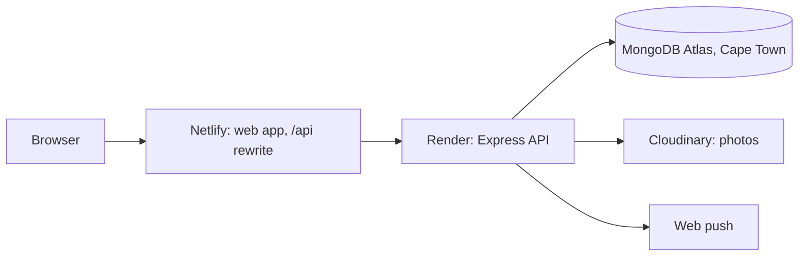

# FEDSA

A progressive web app for Food Excess Distribution South Africa (FEDSA), a non-profit in Salt River, Cape Town.
Donors post surplus food, recipient organisations claim it, and coordinators and administrators track collections and impact.

|            | Production                                | Staging                                      |
| ---------- | ----------------------------------------- | -------------------------------------------- |
| Web app    | https://fedsa-mogi.netlify.app            | https://fedsa-staging.netlify.app            |
| API health | https://fedsa-mogi.netlify.app/api/health | https://fedsa-staging.netlify.app/api/health |

The API for this demo runs on Render's free plan and sleeps after about 15 minutes idle.

**The first request can take up to a minute, and may appear to have failed, refresh if you get a failure to load.**

Presentation video: _link to be added_

## Repository Guide

This table points to where each part of the assessed work can be found.

| Area                                        | Where to look                                                                                                                                                                                                                                                                                                                                                                        |
| ------------------------------------------- | ------------------------------------------------------------------------------------------------------------------------------------------------------------------------------------------------------------------------------------------------------------------------------------------------------------------------------------------------------------------------------------ |
| Back end: programming                       | [apps/api/src/services](apps/api/src/services) has the business rules. [apps/api/src/db/repositories](apps/api/src/db/repositories) is the Repository pattern. [apps/api/src/notifications](apps/api/src/notifications) is the Strategy pattern for notification channels. [organisation-status.ts](apps/api/src/services/organisation-status.ts) is the verification state machine. |
| Back end: database                          | [models](apps/api/src/db/models) and [bootstrap.ts](apps/api/src/db/bootstrap.ts), which applies the `$jsonSchema` validators and the indexes. One index is a partial unique index that stops two active claims on one offer.                                                                                                                                                        |
| Back end: APIs                              | [packages/contract/src/routes.ts](packages/contract/src/routes.ts) lists every endpoint with its role and schemas. [apps/api/src/routes](apps/api/src/routes) and [controllers](apps/api/src/controllers) serve them, and [errors.ts](apps/api/src/errors.ts) defines the one error shape.                                                                                           |
| Back end: security                          | [middleware](apps/api/src/middleware) covers sessions, CSRF, role and ownership guards, rate limits and security headers. [denial-matrix.test.ts](apps/api/test/integration/denial-matrix.test.ts) checks every route against every kind of caller.                                                                                                                                  |
| Back end: data flow and logic               | [claim-service.ts](apps/api/src/services/claim-service.ts) is the claim lock. [expiry-service.ts](apps/api/src/services/expiry-service.ts), [handover-service.ts](apps/api/src/services/handover-service.ts) and [meals.ts](apps/api/src/services/meals.ts) cover the rest of the flow.                                                                                              |
| Hosting                                     | [Why this hosting](#why-this-hosting), [docs/ENVIRONMENTS.md](docs/ENVIRONMENTS.md), [netlify.toml](netlify.toml) and [render.yaml](render.yaml).                                                                                                                                                                                                                                    |
| GitHub: branching                           | `git log --graph --first-parent develop` shows feature branches merged with `--no-ff`, releases into `main`, and the tags `v0.1.0` and `v0.2.0`. [CONTRIBUTING.md](CONTRIBUTING.md) and [CHANGELOG.md](CHANGELOG.md) describe the workflow.                                                                                                                                          |
| GitHub: CI/CD                               | [.github/workflows](.github/workflows): `ci.yml` runs on every push, `staging.yml` deploys `develop`, and `deploy.yml` runs CI on `main` and deploys production only if it passes. [Dependabot](.github/dependabot.yml) is on.                                                                                                                                                       |
| Front end: design and feedback              | [apps/web/src/styles/tokens.css](apps/web/src/styles/tokens.css) has the design tokens. [components/feedback](apps/web/src/components/feedback) is the shared loading, empty, error, success and confirmation kit. Its own README describes it.                                                                                                                                      |
| Front end: accessibility and responsiveness | _results to be added_                                                                                                                                                                                                                                                                                                                                                                |
| Requirements                                | [docs/TRACEABILITY.md](docs/TRACEABILITY.md) matches every user story and non-functional requirement to its endpoints, screens and tests, with an honest status.                                                                                                                                                                                                                     |
| Presentation                                | The video linked at the top of this file.                                                                                                                                                                                                                                                                                                                                            |

## Architecture



| Path                | What it is                                                                |
| ------------------- | ------------------------------------------------------------------------- |
| `apps/web`          | React 19, Vite and TypeScript web app                                     |
| `apps/api`          | Express 5 and Mongoose API with the expiry and retention sweeps           |
| `apps/jobs`         | The sweeps as plain functions, for a cron service later                   |
| `packages/contract` | zod schemas for requests and responses that the web app and the API share |

The browser calls the API on its own origin through a Netlify `/api` rewrite.
Sessions are cookies stored in MongoDB, and every state-changing request needs a CSRF token.

## Why this hosting

- **Netlify** serves the static web app from a CDN.
  Its rewrite keeps the browser and the API on one origin, so cookies and CSRF work without cross-site settings.
- **Render** runs the API as a plain Node service on the free plan, in Frankfurt.
  The expiry sweep runs inside the API every five minutes, so there is no separate cron service to pay for.
  A sleeping API runs no sweep and catches up when it wakes.
- **MongoDB Atlas** stores the data in Cape Town.
  The API processes it in Frankfurt, a cross-border transfer that POPIA section 72 allows.
- **Cloudinary** stores offer and handover photos, and the database keeps only their addresses.
  Lists load small thumbnails.
- Staging and production are separate: separate databases, Render services, Netlify sites and Cloudinary folders.

## API

Every endpoint, with its role and schemas, is in [packages/contract/src/routes.ts](packages/contract/src/routes.ts).
All paths start with `/api`.

| Area            | Endpoints                                                                                                                                                   |
| --------------- | ----------------------------------------------------------------------------------------------------------------------------------------------------------- |
| Health and CSRF | `GET /health`, `GET /auth/csrf`                                                                                                                             |
| Accounts        | `POST /auth/register`, `/auth/login`, `/auth/logout`, `GET /me`, `PATCH /me`, `POST /me/password`                                                           |
| Push            | `GET /push/public-key`, `POST` and `DELETE /me/push-subscriptions`                                                                                          |
| Organisations   | `GET` and `PATCH /organisations/me`, `GET /organisations`, `GET /organisations/:id`, `POST /organisations/:id/verification`, `PUT /organisations/:id/notes` |
| Offers          | `POST` and `GET /offers`, `GET /offers/:id`, `POST /offers/:id/cancel`                                                                                      |
| Claims          | `POST /offers/:id/claim`, `GET /claims`, `POST /claims/:id/release`                                                                                         |
| Dispatch        | `POST /claims/:id/collection`, `PATCH /collections/:id`                                                                                                     |
| Handover        | `POST /offers/:id/handover/donor-confirm`, `/handover/recipient-confirm`, `GET /handovers`, `POST /handovers/:id/resolution`, `GET /handovers/:id/photo`    |
| Notifications   | `GET /notifications`, `POST /notifications/:id/read`                                                                                                        |
| Reports         | `GET /reports/impact`, `/reports/outcomes`, `/reports/export`                                                                                               |
| Certificates    | `GET` and `PUT /valuation-rates`, `POST` and `GET /tax-certificates`, `GET /tax-certificates/:id/pdf`                                                       |
| Users           | `GET` and `POST /users`, `PATCH /users/:id`, `GET /audit-log`                                                                                               |
| Twilio          | `POST /webhooks/twilio/inbound`, `/webhooks/twilio/status`                                                                                                  |

Errors share one shape, which the contract package defines.

## Demo accounts

Seeded on staging.
The password is _to be added_.

| Role          | Name                               | Email                       |
| ------------- | ---------------------------------- | --------------------------- |
| Donor         | Riaan de Villiers, Ouma's Bakery   | `riaan@oumasbakery.example` |
| Recipient     | Nosipho Dlamini, Siyakhula Shelter | `nosipho@siyakhula.example` |
| Coordinator   | Nadia Petersen                     | `nadia@fedsa.example`       |
| Administrator | Zanele Booi                        | `zanele@fedsa.example`      |

The other seeded people are in [apps/api/src/seed/scenario.ts](apps/api/src/seed/scenario.ts).

## Running it locally

Node 22 LTS (see `.nvmrc`), then from the repository root:

```sh
npm install
npm run dev -w apps/web
```

The web app starts on demo data and needs no API.
To use the real API, copy `apps/api/.env.example` to `apps/api/.env` and fill in `MONGODB_URI` and `SESSION_SECRET`.
Transactions need a MongoDB replica set, so use Atlas or a local replica set.
Then run `npm run dev -w apps/api`, seed the database with `npm run seed -w apps/api -- --env=test`, and start the web app with `VITE_DATA=http npm run dev -w apps/web`.
Every environment variable is listed in [docs/ENVIRONMENTS.md](docs/ENVIRONMENTS.md).

## Tests

```sh
npm run check              # lint, type check and unit tests
npm run test:integration   # API against an in-memory replica set
npm run test:contract      # every endpoint's responses against the contract
```

CI runs all of them on every push.
The integration tests include the 20-way claim race, expiry running exactly once, and the dual handover.

## Languages

English, Afrikaans and isiXhosa.
The isiXhosa text has not yet been reviewed by a first-language speaker.

## Known limits

- SMS and WhatsApp delivery is built and tested but was not sent live, because the Twilio trial account refused every message.
  Web push and the in-app inbox are the live channels.
- Not built: offline queueing of forms, automatic monthly certificate issuance, PDF export of reports, a coordinator override of a claim, and a production WhatsApp sender.

## Team

Mogi Group: J. Fanner, L. Manley, X. Bruwer, N. Mukaddam and A. Hussein.
See [CONTRIBUTING.md](CONTRIBUTING.md) for the branching workflow.
