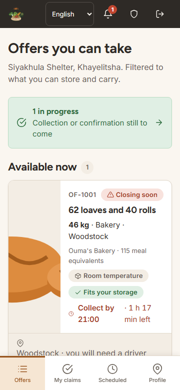
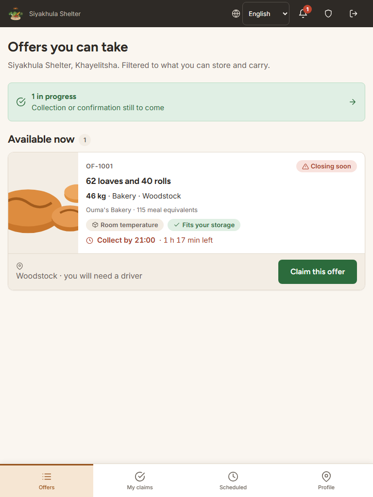
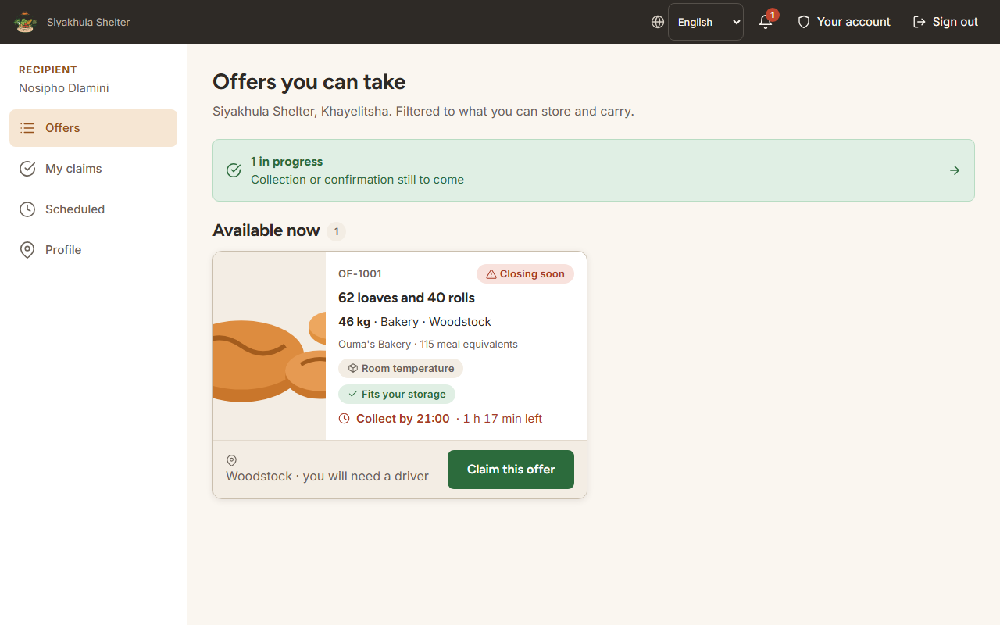
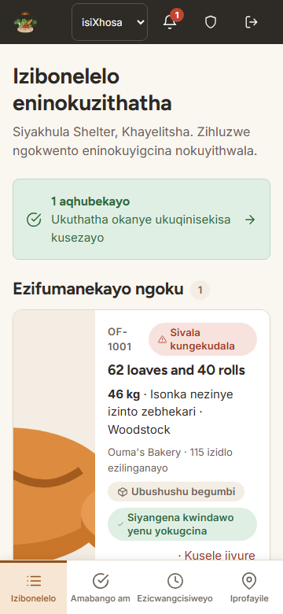
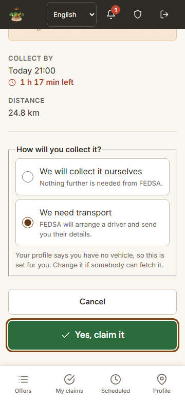
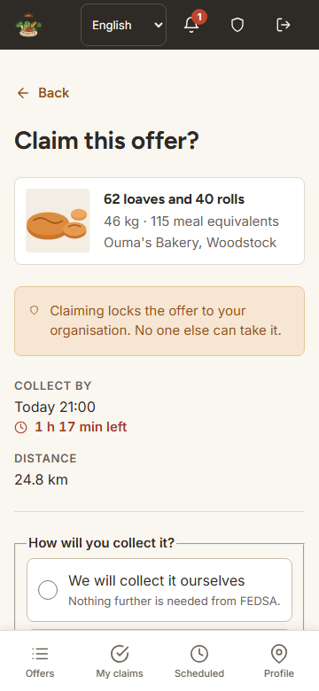
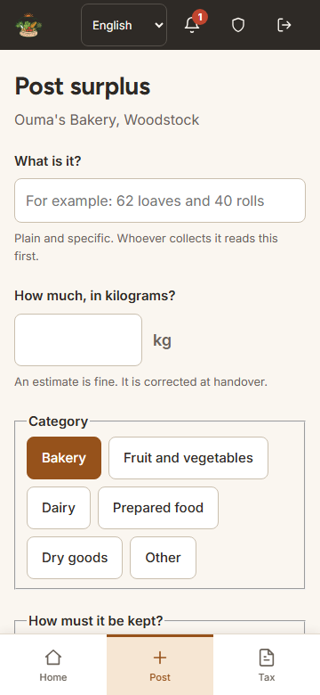
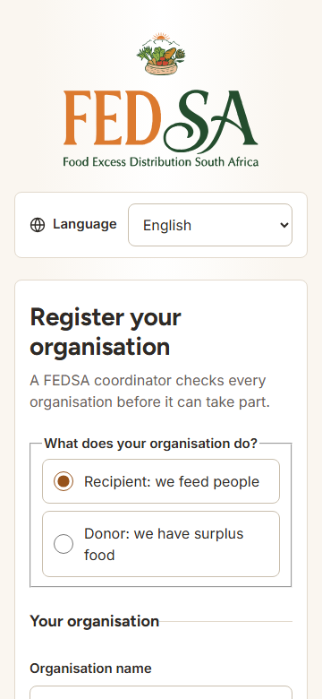
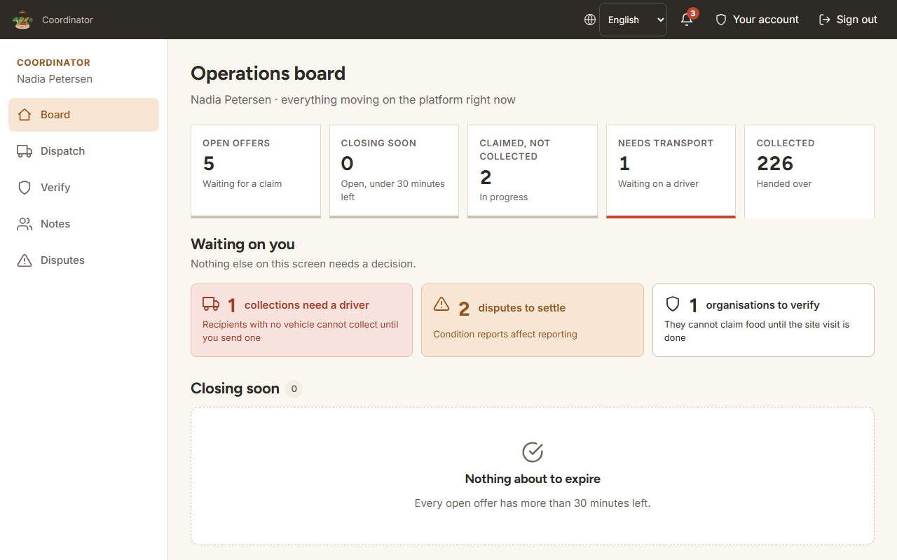
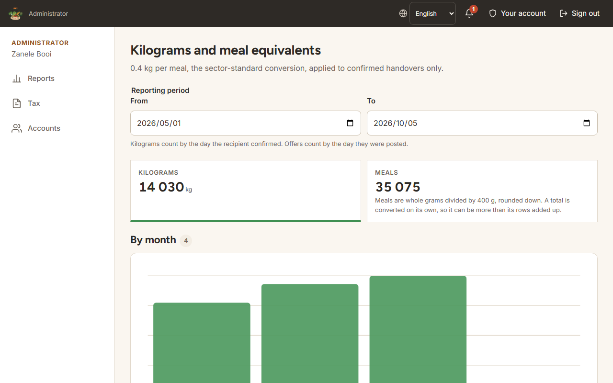

# Accessibility and responsive checks

The web app targets WCAG 2.2 AA (NFR05) on phones from 360 px wide up to desktop.
This page records how every screen was checked on 5 October 2026, what the checks found, and what was fixed.
Since 29 October 2026 an automated axe audit has also run in CI.

## Automated audit

The `accessibility` job in `.github/workflows/ci.yml` runs on every push that changes `apps/web` or `packages/contract`.
It builds the web app on the demo data and serves it with `vite preview`, so it needs no API.
It signs in as a donor, a recipient, a coordinator and an administrator, and opens every screen that role can reach.
It also opens sign-in, registration and the privacy notice signed out.
That is 37 pages, because notifications and change password are opened once for each role.
Each page is checked at 360 px and at 1280 px against the axe rules tagged WCAG 2.0, 2.1 and 2.2 A and AA, 74 checks in all.

The job fails on any violation rated serious or critical.
Moderate and minor violations are listed in the report without failing the job.
The HTML report is uploaded as the `accessibility-report` artifact on every run, pass or fail, and kept for 14 days.

The audit is in `apps/web/a11y/audit.spec.ts`, and its settings are in `apps/web/playwright.config.ts`.

### Running it locally

From the repository root, with port 4173 free:

```sh
npx playwright install chromium        # once
npm run build -w packages/contract     # once, or after the contract changes
npm run test:a11y -w apps/web
npx playwright show-report apps/web/a11y/out/report
```

The run builds the demo version into `apps/web/a11y/out/dist` and leaves the real `dist` alone.
It takes about a minute and a quarter on a recent laptop.

### Results

The first run, on 29 October 2026, found no violations of any impact on any of the 74 checks.

### Accepted exceptions

None.
An accepted exception is listed here with its reason, and `EXCEPTIONS` in `audit.spec.ts` excludes that one rule on that one element.

## How the screens were checked by hand

All 30 screens were opened signed in as each role, on the built-in demo data (`VITE_DATA=fake`).

- **Widths.** Each screen was checked at 360, 768 and 1280 px, and at 640 px, which is a 1280 px window at 200% zoom.
- **Automated rules.** axe-core 4 ran the WCAG 2.0, 2.1 and 2.2 A and AA rules at 360 and 1280 px.
- **Sideways scrolling.** A screen fails if the page scrolls sideways at any width.
- **Target size.** Every link, button and form control was measured against 48 × 48 px, the size the app commits to.
  WCAG 2.2 asks for 24 px.
- **Focus.** Tab moved through every screen at 1280 px, 488 stops in all, and each stop was checked for a visible focus indicator.
- **Keyboard only.** Claiming an offer from the feed, confirming a handover as the donor and then as the recipient, and posting an offer were each done with the keyboard alone.
  The confirmation dialog keeps focus inside it until it closes.

## Results

| Check | Result |
|---|---|
| axe violations rated serious or critical | None on any screen |
| Sideways scrolling at 360, 768 and 1280 px and at 200% zoom | None |
| Targets smaller than 48 × 48 px | None. The photo picker's file input is hidden, and its visible label is the target |
| Visible focus at every tab stop | Yes. Date fields show the ring on the field, and chart bars take a dark outline |
| Keyboard-only claim, handover and posting | All complete without a mouse |
| Toasts read out by screen readers | Yes, through a polite live region |
| Languages | Every signed-in screen has the English, Afrikaans and isiXhosa picker in its header |

## Fixed in this pass

| Problem | Before | After |
|---|---|---|
| Warning and alert figures on the report and board tiles used the brand amber and red as text | 3.4:1 against white | Darker text colours, 6.0:1 and 6.5:1 |
| Notes on the coordinator board's to-do tiles were faded to 85% | 3.7:1 and 4.0:1 | Full strength, 4.9:1 and 5.2:1 |
| Disabled accounts were faded to 55% | As low as 2.4:1 | A dashed card on a darker background, at full strength. The status badge still says the account is disabled |
| Header controls (organisation link, language picker, notifications, account, sign out) at 360 px | 24 to 36 px | 48 px. Below 400 px the organisation name is hidden from view and still names the link for screen readers |
| Text links on sign-in and registration, and the headings of collapsible sections | Under 48 px tall | 48 px tall |

## Not covered by this pass

- A screen reader on a phone.
  Claiming an offer with TalkBack on Android needs a real device and was not part of this pass.
- Contrast inside photographs, which no automated rule can judge.

## Screenshots

| Screen | Phone (360 px) | Tablet (768 px) | Desktop (1280 px) |
|---|---|---|---|
| Recipient: offers |  |  |  |

| Screen | Screenshot |
|---|---|
| Recipient: offers in isiXhosa |  |
| Recipient: claim, with keyboard focus on the confirm button |  |
| Recipient: claim |  |
| Donor: post an offer |  |
| Registration |  |
| Coordinator: operations board |  |
| Administrator: kilograms and meals report |  |
